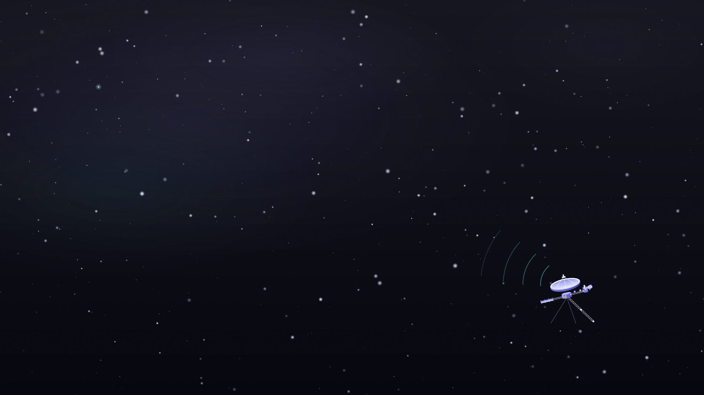

# Wallpaper (awww + voyager-sky)

The desktop wallpaper is the real sky, centered on where **Voyager 1** actually is: in Ophiuchus, near the border with Hercules, 173 AU from the Sun. Its position comes from [JPL Horizons](https://ssd.jpl.nasa.gov/horizons/), queried for Taipei. The sky is a full celestial sphere, and you can turn it to any part of the sky in **drag mode**. When you leave drag mode, the view becomes your wallpaper and your lock screen.



What the sky shows:

- **Constellation stars only.** Only the ~700 stars that make up the 88 constellation figures are drawn, each at its catalogue brightness (V magnitude) and true colour (B-V index → temperature → blackbody colour). That's why Antares, Arcturus and Betelgeuse look orange and Rigel and Vega blue-white.
- **The Milky Way**, from NASA's all-sky star map with the stars filtered out, in its true place: the bright band with its dark rifts, about 27° to Voyager's left. The Magellanic Clouds show up in the southern sky.
- **Tiny faint stars**, scattered as before and thickest toward the Milky Way.
- **The probe** (the voyager logo), drawn on Voyager 1's position whenever that part of the sky is in view.
- No galaxies or nebulae: they're too dim to see.

The view is drawn north up, with east to the left, as you see the sky from inside the sphere.

## Install

You need Hyprland started through [uwsm](https://github.com/Vladimir-csp/uwsm) (`uwsm start hyprland.desktop`). awww runs as a systemd user service that starts with your graphical session, and plain `Hyprland` from a TTY never starts one. The installer checks this.

```bash
sudo pacman -S awww rust
./awww/install.sh               # build voyager-sky, start awww, show the sky
./awww/install.sh --restore     # stop awww, put your own awww.service back (or remove voyager's)
```

The installer:

- builds `voyager-sky` (a small Rust program; the first build takes a few minutes)
- installs it with the sky data to `~/.config/hypr/voyager/` and links it as `~/.config/scripts/voyager-sky`
- renders the wallpaper at your largest monitor's size

The first time, Voyager 1 is in the middle. After that, re-running the installer keeps the view you chose. awww is the only wallpaper daemon voyager uses. You do not need hyprpaper, and the installer leaves it alone.

## Drag mode

**Hold the left button on empty desktop** for about half a second, without moving, and drag mode opens with the sky already in your hand: keep holding and drag. This needs `voyager-sky listen` running, so start it with Hyprland, e.g. in `hyprland.lua`:

```lua
hl.on("hyprland.start", function()
    hl.exec_cmd(os.getenv("HOME") .. "/.config/scripts/voyager-sky listen")
end)
```

`listen` puts an invisible surface under your windows on every monitor. It only gets clicks where no window covers the desktop, so holding the button over a window, or a quick click on the desktop, does nothing. While waiting it uses about 6 MB of memory and no CPU.

You can still bind a key to `voyager-sky toggle` if you want drag mode from the keyboard.

While drag mode is on, the live sky sits on the desktop behind your windows, so windows keep working.

| Do this | What happens |
|---|---|
| Drag on an empty part of the desktop | Turns the sky. The point you grab stays under the cursor. |
| Scroll | Zooms in or out (40°–140° across a 1920 px screen) |
| `C`, or the **lines** chip | Shows or hides the constellation lines, which flicker slowly in blue, and their names |
| `L`, or the **中文 / English** chip | Switches the names between Traditional Chinese and English |
| Move the cursor near a constellation | Its lines and name light up |
| Move the cursor near Voyager 1 | The probe fades in, a bit larger than on the wallpaper |
| `Esc`, or the **set as wallpaper** chip | Ends drag mode and makes the view the wallpaper (with `listen`, it goes back to waiting) |

Drag mode takes the keyboard while it's on, so `C`, `L` and `Esc` work straight away.

**More than one monitor.** In drag mode the monitors form one wide sky, laid out like your monitors: drag across the seam and the sky keeps going. The monitor you start drag mode on (where you held the button, or where the cursor is for `toggle`) keeps showing exactly your wallpaper, and the others extend it. When you leave, the view on **that starting monitor** becomes the wallpaper, wherever the cursor is by then, and every monitor shows it.

**What drag mode leaves on the wallpaper.** The lines, names and chips are never part of the wallpaper. The wallpaper (`wallpaper.png`) includes the probe if Voyager 1 is in view. The lock screen's copy (`lock.png`) has no probe, because hyprlock draws its own big probe.

**Cost.** Drag mode draws frames only while something moves: a drag, a fade, or the flickering lines while they're on. It sets up the GPU when it opens and frees it when you leave the mode, so `listen` holds no GPU memory while it waits. The wallpaper itself is a still image, so it uses nothing once shown.

## Commands

```bash
voyager-sky listen                       # wait for a long-press on empty desktop, then drag mode
voyager-sky toggle                       # start drag mode, or end it and set the wallpaper
voyager-sky apply                        # re-render wallpaper.png + lock.png from the saved view and show it
voyager-sky export --view 83,0,90 --size 3840x2160 --out orion.png   # any view to a PNG (RA,Dec[,FOV] in degrees)
voyager-sky export --overlay --cursor 960,540 --out preview.png      # what drag mode looks like (lines + names)
```

The saved view is in `~/.config/hypr/voyager/view.json` (`ra`, `dec`, `fov`). Delete it and run `voyager-sky apply` to put Voyager 1 back in the middle.

## Data

Everything the sky draws is in [`awww/sky/`](sky/), built once and committed:

| File | What | Made by |
|---|---|---|
| `voyager1.json` | Voyager 1's RA/Dec (ICRF), distance, galactic l/b | `src/query-horizons.sh` (JPL Horizons API, observer Taipei) |
| `constellations.json` | 88 figures, their stars (position, V, colour) and names in English and 繁體中文 | `src/build-sky-data.py` |
| `field.bin` | 60,000 faint background stars, seeded | `src/build-sky-data.py` |
| `milkyway.png` | the diffuse Milky Way, equirectangular | `src/build-sky-data.py` |
| `probe.png` | the probe | `src/build-sky-data.py` (from `src/logo.svg`) |

Voyager 1 is so far away that it sits at the same point of the sky from anywhere on Earth (within 0.05″). It moves about 0.3° a year, so the query doesn't need re-running. If you ever want a fresh position, run `src/query-horizons.sh`, then `./awww/install.sh`.

Sources:

- constellation figures and Chinese names from [Stellarium](https://github.com/Stellarium/stellarium)'s modern sky culture and its zh_TW translation (CC BY-SA 4.0)
- star positions, magnitudes and colours from the [HYG database](https://github.com/astronexus/HYG-Database) v4.1 (CC BY-SA 4.0, from Hipparcos)
- the Milky Way from NASA/Goddard Scientific Visualization Studio's [Deep Star Maps 2020](https://svs.gsfc.nasa.gov/4851)
- Voyager 1's position from NASA/JPL Horizons

## If it breaks

Start with `./doctor.sh awww`.

| Symptom | Do this |
|---|---|
| Installer says "No systemd graphical session" | start Hyprland with `uwsm start hyprland.desktop` |
| No wallpaper after login | `systemctl --user restart awww`; why: `journalctl --user -u awww -n 20` |
| Wallpaper looks soft on a new, bigger monitor | `voyager-sky apply` (renders at the largest monitor's size) |
| Holding the button on the desktop does nothing | is it running? `pgrep -a voyager-sky`; if not, run `~/.config/scripts/voyager-sky listen` in a terminal to see the error |
| "already listening" | one is already running; restart it with `pkill -x voyager-sky`, then start `listen` again |
| The keybind does nothing | run `~/.config/scripts/voyager-sky toggle` in a terminal to see the error |
| "drag mode is already on" | end it with `voyager-sky toggle`; a stuck one: `pkill -x voyager-sky` |
| Drag mode's keys don't work | click the sky once to give it the keyboard |
| "no Vulkan GPU found" | install your GPU's Vulkan driver: `vulkan-intel`, `vulkan-radeon` or `nvidia-utils` |
| Chinese names show as boxes | `sudo pacman -S noto-fonts-cjk` |
